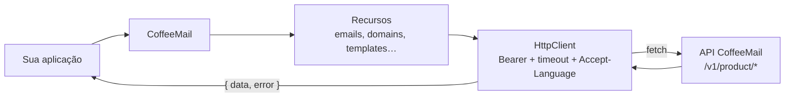

<div align="center">

# ☕ CoffeeMail Node.js SDK

**SDK oficial do CoffeeMail para Node.js e TypeScript (`@coffeemail/node`): envio transacional, domínios, templates, audiências, campanhas e webhooks com retorno `{ data, error }`.**

[](https://www.npmjs.com/package/@coffeemail/node)
[](https://nodejs.org)
[](https://nodejs.org/api/packages.html)
[](https://github.com/Coffee-Mail/coffee-mail-sdk-node/actions/workflows/ci.yml)
[](./LICENSE)

[Instalação](#-instalação) · [Início rápido](#-início-rápido) · [Configuração](#️-configuração) · [Erros](#️-tratamento-de-erros) · [Referência](#-referência) · [Webhooks](#-webhooks)

</div>

---

## 📑 Sumário

- [Visão geral](#-visão-geral)
- [Status do projeto](#-status-do-projeto)
- [Requisitos](#-requisitos)
- [Instalação](#-instalação)
- [Início rápido](#-início-rápido)
- [Configuração](#️-configuração)
- [Tratamento de erros](#️-tratamento-de-erros)
- [Referência](#-referência)
- [Webhooks](#-webhooks)
- [Versionamento e releases](#-versionamento-e-releases)
- [Testes e qualidade](#-testes-e-qualidade)
- [Estrutura do repositório](#️-estrutura-do-repositório)
- [Contribuição](#-contribuição)
- [Projetos relacionados](#-projetos-relacionados)
- [Licença](#-licença)

## ✨ Visão geral

`@coffeemail/node` é o cliente da API de Produto do CoffeeMail (rotas `/v1/product/*`). Cada recurso da API vira uma propriedade do client (`emails`, `domains`, `templates`, `audiences`, `broadcasts`, `senders`, `suppressions`, `webhooks`, `stats`, `validation`), e toda chamada HTTP devolve um envelope `{ data, error }` em vez de lançar exceção.

- **TypeScript estrito**: tipos públicos escritos à mão em `src/types/`, conferidos em tempo de compilação contra os tipos gerados do OpenAPI da API (`src/generated/contract-check.ts`).
- **ESM e CommonJS**: build dual com `tsup` (`dist/index.js` e `dist/index.cjs`, com `.d.ts`).
- **Sem dependências de runtime**: usa o `fetch` global e os módulos nativos `node:crypto` e `node:buffer`.
- **Mensagens localizadas**: erros gerados pelo próprio SDK em `pt-BR` (padrão) ou `en`; o idioma também vai no header `Accept-Language` para a API.



## 🚦 Status do projeto

| Item | Situação |
| --- | --- |
| Versão publicada no npm | `0.2.1` (tag `latest`) |
| Versão no `package.json` da `main` | `0.3.0` (não publicada; ver [CHANGELOG](./CHANGELOG.md)) |
| Maturidade | Pré-1.0 (`0.x`). A superfície pública segue a política de compatibilidade abaixo mesmo assim. |

Limitações conhecidas, verificadas no código atual:

- **A `main` está à frente do npm.** A `0.3.0` corrige a verificação de webhook, os campos descartados em `emails.send()` e o contexto dos erros, e tipa `senders`, `suppressions.bulkCreate` e `broadcasts.testSend`. Até ser publicada, o pacote `0.2.1` do npm mantém os defeitos listados no [CHANGELOG](./CHANGELOG.md).
- **URL base fixa**: as requisições vão sempre para `https://api.coffeemail.com.br`. Não existe opção para apontar para outro host.
- **Sem retry automático**: o SDK não repete requisições. Em `429`, o valor de `Retry-After` (quando numérico) fica em `RateLimitError.retryAfterSeconds` para você decidir.
- **Agendamento de campanhas não é suportado**: `broadcasts.create` não aceita `scheduledAt` (a API recusa campos desconhecidos).
- **Runtime**: testado em Node.js. O código importa `node:crypto` e `node:buffer`; outros runtimes (Deno, Bun, edge) não são testados.

## 📋 Requisitos

| Uso | Requisito |
| --- | --- |
| Consumir o pacote | Node.js `>=18` (campo `engines`; depende do `fetch` global) |
| Desenvolver no repositório | Node.js 22 e pnpm `11.26.0` (versões usadas no CI e em `packageManager`) |
| Credencial | Chave de API de Produto do CoffeeMail (`cm_live_…`), criada no dashboard |

## 📦 Instalação

```bash
pnpm add @coffeemail/node
```

```bash
npm install @coffeemail/node
```

```bash
yarn add @coffeemail/node
```

ESM e CommonJS funcionam sem configuração extra:

```typescript
import { CoffeeMail } from "@coffeemail/node";
```

```javascript
const { CoffeeMail } = require("@coffeemail/node");
```

## 🚀 Início rápido

```typescript
import { CoffeeMail } from "@coffeemail/node";

const coffeemail = new CoffeeMail(process.env.COFFEEMAIL_API_KEY);

const { data, error } = await coffeemail.emails.send({
  from: "Loja Exemplo <contato@seudominio.com.br>",
  to: "cliente@exemplo.com.br",
  subject: "Confirmação do pedido #4521",
  html: "<h1>Obrigado pela compra!</h1><p>Seu pedido está em processamento.</p>",
  idempotencyKey: "pedido-4521-confirmacao",
});

if (error) {
  console.error(`[${error.status}] ${error.code}: ${error.message}`);
  process.exit(1);
}

console.log(data.id, data.status);
```

`data.status` é `"queued"` ou `"scheduled"`: o envio é enfileirado pela API e processado de forma assíncrona. Acompanhe a entrega com `emails.get(id)`, `emails.getEvents(id)` ou [webhooks](#-webhooks).

O domínio do remetente precisa estar verificado na sua organização (`domains.create` + `domains.verify`) ou o endereço cadastrado como remetente verificado (`senders`).

## ⚙️ Configuração

```typescript
new CoffeeMail(apiKey?: string, options?: CoffeeMailClientOptions)
```

| Parâmetro | Tipo | Padrão | Descrição |
| --- | --- | --- | --- |
| `apiKey` | `string` | `process.env.COFFEEMAIL_API_KEY` | Chave de API de Produto. Enviada como `Authorization: Bearer <apiKey>`. |
| `options.locale` | `"pt-BR" \| "en"` | `"pt-BR"` | Idioma das mensagens geradas pelo SDK e valor do header `Accept-Language`. |
| `options.timeoutMs` | `number` | `10000` | Tempo limite por requisição, em milissegundos. Ao estourar, retorna `NetworkError`. |
| `options.fetch` | `typeof fetch` | `globalThis.fetch` | Implementação de `fetch` customizada (testes, proxy, instrumentação). |

| Variável de ambiente | Uso |
| --- | --- |
| `COFFEEMAIL_API_KEY` | Lida apenas quando `apiKey` não é passado ao construtor. |

Comportamentos fixos, sem opção de configuração:

- URL base `https://api.coffeemail.com.br`.
- Header `User-Agent: coffeemail-node/<versão>`.
- Sem retry automático.

Se nenhuma chave for encontrada (argumento ausente e variável vazia), **o construtor lança** `AuthenticationError`. É a única situação de configuração que lança em vez de retornar envelope.

```typescript
import { CoffeeMail } from "@coffeemail/node";

const coffeemail = new CoffeeMail("cm_live_sua_chave", {
  locale: "en",
  timeoutMs: 5_000,
});
```

### Introspecção da chave

| Método | Retorno | Endpoint |
| --- | --- | --- |
| `introspect(forceRefresh = false)` | `CoffeeMailResponse<ApiKeyIntrospection>` | `GET /v1/product/auth/me/api-key` |
| `invalidateApiKeyCache()` | `void` | — |

`ApiKeyIntrospection` traz `id`, `name`, `organisationId` e `scopes`. O resultado de sucesso fica em cache na instância por 5 minutos; `forceRefresh: true` ou `invalidateApiKeyCache()` ignoram o cache.

```typescript
const { data: key } = await coffeemail.introspect();
console.log(key?.organisationId, key?.scopes);
```

## 🛡️ Tratamento de erros

Toda chamada HTTP retorna `CoffeeMailResponse<T>`:

```typescript
type CoffeeMailResponse<T> =
  | { readonly data: T; readonly error: null }
  | { readonly data: null; readonly error: CoffeeMailError };
```

Falhas de rede, timeout e respostas não-2xx viram `error`; a promise não é rejeitada nesses casos. Exceções que **lançam**:

- `new CoffeeMail()` sem chave: `AuthenticationError` síncrono.
- `emails.send`/`emails.sendBatch` com participante em formato inválido (objeto sem `email` string): a promise é rejeitada com `ValidationError` antes de qualquer requisição.

```typescript
import { NotFoundError, RateLimitError } from "@coffeemail/node";

const { data, error } = await coffeemail.emails.get("id-do-email");

if (error instanceof NotFoundError) {
  console.warn("E-mail não encontrado");
} else if (error instanceof RateLimitError) {
  console.warn(`Tente de novo em ${error.retryAfterSeconds ?? "?"}s`);
} else if (error) {
  console.error(error.status, error.code, error.message);
} else {
  console.log(data.status);
}
```

Todas as classes estendem `CoffeeMailError` e são exportadas pelo pacote. Campos comuns:

- `status`: status HTTP (0 em falha de rede).
- `code`: código canônico da classe (tabela abaixo), igual em todos os SDKs oficiais.
- `apiCode`: código original enviado pela API, quando houver. Um `429` pode ser `RATE_LIMIT_EXCEEDED` (limite de requisições), `PLAN_QUOTA_EXCEEDED` (cota do plano esgotada) ou `VALIDATION_CREDITS_EXHAUSTED` (créditos de validação do mês esgotados); só o primeiro vale repetir depois de `retryAfterSeconds`.
- `message`: mensagem da API ou, na falta dela, a do SDK no `locale` configurado.
- `details`: `error.meta` e `error.details` da resposta unidos num objeto (em validação, `details.issues` lista os campos inválidos).
- `requestId`: valor do header `x-request-id` da resposta, útil para suporte.

| Classe | `status` | `code` | Quando ocorre |
| --- | --- | --- | --- |
| `ValidationError` | 400 | `VALIDATION_ERROR` | Payload ou parâmetros rejeitados pela API; também lançada localmente para participante de e-mail inválido. |
| `AuthenticationError` | 401 | `UNAUTHORIZED` | Chave inválida, revogada ou ausente (inclusive no construtor). |
| `PaymentRequiredError` | 402 | `PAYMENT_REQUIRED` | Cota do plano esgotada ou recurso que exige upgrade. |
| `ForbiddenError` | 403 | `FORBIDDEN` | A chave não tem permissão para a operação. |
| `PermissionError` | 403 | `PERMISSION_DENIED` | Em `broadcasts.*`, um 403 é convertido nesta classe, com `requiredPermission: "full_access"` e `details.operation`. |
| `NotFoundError` | 404 | `NOT_FOUND` | Recurso inexistente ou de outra organização. |
| `ConflictError` | 409 | `CONFLICT` | Conflito com recurso existente (ex.: domínio duplicado). |
| `RateLimitError` | 429 | `RATE_LIMIT_EXCEEDED` | Limite de requisições excedido. `retryAfterSeconds` vem do header `Retry-After` quando numérico. |
| `InternalServerError` | 500 | `INTERNAL_SERVER_ERROR` | Respostas 500, 502, 503 e 504 (o `status` da instância é sempre 500). |
| `NetworkError` | 0 | `NETWORK_ERROR` | Falha de rede/DNS ou timeout (`timeoutMs`). |
| `CoffeeMailError` | status HTTP | `apiCode` ou `API_ERROR` | Qualquer outro status não-2xx. |

A mensagem vem de `error.message` da resposta da API (localizada pelo `Accept-Language`); se a resposta não trouxer mensagem, o SDK usa a sua própria, no `locale` configurado.

## 📚 Referência

Os endpoints abaixo são relativos a `https://api.coffeemail.com.br` e todos os métodos retornam `Promise<CoffeeMailResponse<T>>`, exceto onde indicado. Os recursos também são exportados como classes (`Emails`, `Domains`, `Templates`, `Audiences`, `Contacts`, `Broadcasts`, `Senders`, `Suppressions`, `Webhooks`, `Stats`), além de `COFFEEMAIL_VERSION` e de todos os tipos de payload e resposta.

### Emails — `coffeemail.emails`

| Método | Descrição | Endpoint |
| --- | --- | --- |
| `send(payload: SendEmailPayload)` | Enfileira um e-mail transacional. | `POST /v1/product/emails` |
| `sendBatch(items: SendEmailPayload[])` | Enfileira vários e-mails numa requisição; resultado por item (`{ ok, data }` ou `{ ok, error }`). | `POST /v1/product/emails/batch` |
| `get(id)` | Detalhe e status de um e-mail. | `GET /v1/product/emails/{id}` |
| `list(query?: ListEmailsQuery)` | Histórico com filtros e paginação por cursor (`after` / `nextCursor`). | `GET /v1/product/emails` |
| `getEvents(id)` | Linha do tempo de eventos de entrega. | `GET /v1/product/emails/{id}/events` |
| `getTags()` | Tags distintas já usadas pela organização. | `GET /v1/product/emails/tags` |
| `cancel(id)` | Cancela um envio agendado (204, `data` sem corpo). | `POST /v1/product/emails/{id}/cancel` |
| `resend(id)` | Reenvia um e-mail existente. | `POST /v1/product/emails/{id}/resend` |

Detalhes de `SendEmailPayload`:

- `from`, `to`, `cc`, `bcc` e `replyTo` aceitam `"email@dominio"`, `"Nome <email@dominio>"` ou `{ email, name? }`. `to` é um destinatário único; `cc`/`bcc` aceitam lista.
- Conteúdo por `html`/`text` ou por `templateId` (id ou alias do template) + `variables`.
- `scheduledAt` aceita `Date` ou string ISO 8601.
- `attachments[].content` aceita string (Base64) ou `Uint8Array`/`Buffer` (convertido para Base64). `contentType` padrão `application/octet-stream`, `disposition` padrão `attachment`, `cid` para imagens inline.
- `tags: { name, value }[]` e `headers: Record<string, string>`.
- `emailType` (`transactional` ou `broadcast`), `suppressionCategory` e `metadata` (objeto livre guardado com o e-mail) são enviados como estão.
- `idempotencyKey` vira o header `x-idempotency-key`; `isSandbox: true` vira `x-coffeemail-sandbox: true` (simula a entrega). Em `sendBatch`, esses headers valem para a requisição inteira.

Filtros de `list`: `status`, `recipient`, `fromEmail`, `subjectContains`, `apiKeyId`, `tag`, `from`, `to`, `after`, `limit`.

```typescript
const { data } = await coffeemail.emails.list({ status: "delivered", limit: 50 });

for (const email of data?.emails ?? []) {
  console.log(email.id, email.status);
}

const next = data?.nextCursor
  ? await coffeemail.emails.list({ after: data.nextCursor, limit: 50 })
  : null;
```

### Domains — `coffeemail.domains`

| Método | Descrição | Endpoint |
| --- | --- | --- |
| `create({ name })` | Registra um domínio e retorna os registros DNS a publicar (`dkimRecordsToPublish`). | `POST /v1/product/domains` |
| `list()` | Lista os domínios da organização. | `GET /v1/product/domains` |
| `get(id)` | Detalhe do domínio com `dnsRecordsToPublish`, `dkimRotation`, `returnPath`, `trackingDomain` e `trackingDomainsAvailable`. | `GET /v1/product/domains/{id}` |
| `verify(id)` | Verifica SPF, DKIM e DMARC agora; retorna `status` e `checks`. | `POST /v1/product/domains/{id}/verify` |
| `delete(id)` | Remove o domínio. | `DELETE /v1/product/domains/{id}` |
| `getHealth(id)` | Diagnóstico de SPF/DKIM/DMARC em tempo real. | `POST /v1/product/domains/{id}/health` |
| `getWarmupStatus(id)` | Progresso do aquecimento do domínio (ou `null`), com `status` (`warming`, `completed`), `totalDays`, `startedAt` e `completedAt`. | `GET /v1/product/domains/{id}/warmup` |
| `rotateDkim(id)` | Inicia a rotação da chave DKIM e devolve o registro TXT do novo seletor. Idempotente: com rotação pendente, devolve a mesma. Domínio não verificado → `ConflictError` (`apiCode` `DOMAIN_NOT_VERIFIED`). | `POST /v1/product/domains/{id}/dkim/rotate` |
| `setTrackingDomain(id, { host })` | Cadastra o host de tracking próprio (links de abertura e clique) e devolve o CNAME a publicar. Host inválido → `ValidationError` (`INVALID_TRACKING_HOST`); recurso desligado → `ConflictError` (`TRACKING_DOMAINS_DISABLED`). | `PUT /v1/product/domains/{id}/tracking-domain` |
| `removeTrackingDomain(id)` | Remove o host de tracking próprio; `data` é `null`. | `DELETE /v1/product/domains/{id}/tracking-domain` |

_A partir da 0.3.0_: os campos opcionais `statusReason` (`dns_records_missing`, `provider_pending`, `provider_failed`), `sendingIdentity` (`provider`, `state`, `lastSyncedAt`) e `checks.*.resolution` (`found`, `absent`, `unknown`).

```typescript
const { data: domain } = await coffeemail.domains.create({ name: "seudominio.com.br" });
console.log(domain?.dkimRecordsToPublish);

const { data: check } = await coffeemail.domains.verify(domain!.id);
console.log(check?.status, check?.checks.dkim.ok);

const { data: rotation } = await coffeemail.domains.rotateDkim(domain!.id);
console.log(rotation?.selector, rotation?.record);

const { data: tracking } = await coffeemail.domains.setTrackingDomain(domain!.id, {
  host: "links.seudominio.com.br",
});
console.log(tracking?.record, tracking?.verified);
```

### Templates — `coffeemail.templates`

| Método | Descrição | Endpoint |
| --- | --- | --- |
| `create(payload)` | Cria um template (HTML ou React Email). | `POST /v1/product/templates` |
| `list(query?: { limit?, after? })` | Lista templates em `templates` (`data` é alias depreciado). | `GET /v1/product/templates` |
| `get(id)` | Detalhe do template. | `GET /v1/product/templates/{id}` |
| `update(id, payload)` | Atualização parcial. | `PATCH /v1/product/templates/{id}` |
| `delete(id)` | Remove o template (204). | `DELETE /v1/product/templates/{id}` |
| `preview({ html, format?, variables? })` | Renderiza sem persistir e sem sanitizar. | `POST /v1/product/templates/preview` |
| `previewById(id, variables?)` | Busca o template e renderiza a prévia (duas requisições). | `GET /v1/product/templates/{id}` + `POST /v1/product/templates/preview` |
| `format(payload)` | Formata o código-fonte com Prettier, sem persistir. | `POST /v1/product/templates/format` |
| `testRender(payload)` | Renderiza e sanitiza o HTML (remove scripts, iframes, `javascript:` e handlers inline). | `POST /v1/product/templates/test-render` |
| `testSend(id, { to, variables? })` | Envia um e-mail de teste real com o template. | `POST /v1/product/templates/{id}/test-send` |
| `listVersions(id, query?: { limit?, offset? })` | Versões gravadas, da mais recente para a mais antiga (`data`, `total`; `limit` 1–100). | `GET /v1/product/templates/{id}/versions` |
| `getVersion(id, version)` | Conteúdo completo de uma versão (`html`, `variables`, `format`, ...). | `GET /v1/product/templates/{id}/versions/{version}` |
| `restoreVersion(id, version)` | Restaura o template para a versão e devolve o template atualizado. | `POST /v1/product/templates/{id}/versions/{version}/restore` |

```typescript
const { data: template } = await coffeemail.templates.create({
  name: "boas-vindas",
  subject: "Bem-vindo, {{ nome }}!",
  html: "<h1>Olá, {{ nome }}!</h1>",
});

const { data: preview } = await coffeemail.templates.previewById(template!.id, { nome: "Ana" });
console.log(preview?.html);
```

Versões inexistentes respondem `NotFoundError` com `apiCode` `TEMPLATE_VERSION_NOT_FOUND` (template inexistente: `TEMPLATE_NOT_FOUND`).

```typescript
const { data: versions } = await coffeemail.templates.listVersions(template!.id, { limit: 10 });
await coffeemail.templates.restoreVersion(template!.id, versions!.data[1]!.version);
```

### Audiences — `coffeemail.audiences`

| Método | Descrição | Endpoint |
| --- | --- | --- |
| `create({ name, description? })` | Cria uma audiência. | `POST /v1/product/audiences` |
| `list(query?: { limit?, offset? })` | Lista audiências (paginação por offset). | `GET /v1/product/audiences` |
| `get(id)` | Detalhe da audiência (`totalContacts`; `contactsCount` é alias depreciado). | `GET /v1/product/audiences/{id}` |
| `update(id, { name?, description?, active? })` | Atualiza a audiência. | `PUT /v1/product/audiences/{id}` |
| `delete(id)` | Remove a audiência e seus contatos (204). | `DELETE /v1/product/audiences/{id}` |
| `listContacts(audienceId, query?)` | Atalho para `contacts.list`. | `GET /v1/product/audiences/{id}/contacts` |
| `createContact(audienceId, payload)` | Atalho para `contacts.create`. | `POST /v1/product/audiences/{id}/contacts` |
| `bulkAddContacts(audienceId, payload)` | Atalho para `contacts.bulkAdd`. | `POST /v1/product/audiences/{id}/contacts/bulk` |

Sub-recurso `coffeemail.audiences.contacts`:

| Método | Descrição | Endpoint |
| --- | --- | --- |
| `create(audienceId, { email, firstName?, lastName?, metadata? })` | Adiciona um contato. | `POST /v1/product/audiences/{id}/contacts` |
| `list(audienceId, query?: { limit?, offset? })` | Lista contatos e `total`. | `GET /v1/product/audiences/{id}/contacts` |
| `bulkAdd(audienceId, { contacts })` | Adiciona até 10.000 contatos; retorna `inserted`, `skipped` e `errors`. | `POST /v1/product/audiences/{id}/contacts/bulk` |
| `update(audienceId, contactId, payload)` | Atualiza `firstName`, `lastName`, `metadata`. | `PUT /v1/product/audiences/{id}/contacts/{contactId}` |
| `delete(audienceId, contactId)` | Remove o contato (204). | `DELETE /v1/product/audiences/{id}/contacts/{contactId}` |

```typescript
const { data: audience } = await coffeemail.audiences.create({ name: "Newsletter" });

const { data: result } = await coffeemail.audiences.bulkAddContacts(audience!.id, {
  contacts: [
    { email: "ana@exemplo.com", firstName: "Ana" },
    { email: "bruno@exemplo.com" },
  ],
});
console.log(result?.inserted, result?.skipped);
```

### Broadcasts — `coffeemail.broadcasts`

Exigem chave com permissão `full_access`; um 403 chega como `PermissionError`.

| Método | Descrição | Endpoint |
| --- | --- | --- |
| `create(payload)` | Cria a campanha: `audienceId` + `fromEmail` + (`templateId` ou `html` + `subject`), com `text`, `replyTo`, `variables` opcionais. | `POST /v1/product/broadcasts` |
| `list(query?)` | Lista com filtros `status`, `from`, `to`, `after`, `limit`. | `GET /v1/product/broadcasts` |
| `get(id)` | Detalhe e contadores (`recipientsTotal`, `recipientsQueued`, `recipientsFailed`). | `GET /v1/product/broadcasts/{id}` |
| `send(id)` | Dispara a campanha para a audiência. | `POST /v1/product/broadcasts/{id}/send` |
| `cancel(id)` | Cancela a campanha. | `POST /v1/product/broadcasts/{id}/cancel` |
| `testSend(id, { to, variables? })` | Envio de teste para um destinatário; retorna `{ success, messageId, recipient }`. | `POST /v1/product/broadcasts/{id}/test-send` |

```typescript
const { data: broadcast, error } = await coffeemail.broadcasts.create({
  audienceId: "id-da-audiencia",
  fromEmail: "news@seudominio.com.br",
  templateId: "id-do-template",
});

if (!error) {
  await coffeemail.broadcasts.send(broadcast.id);
}
```

### Senders — `coffeemail.senders`

Remetentes verificados por endereço, alternativa à verificação do domínio inteiro.

| Método | Descrição | Endpoint |
| --- | --- | --- |
| `create({ email, displayName? })` | Cadastra o remetente e dispara o e-mail de verificação; retorna `CreatedSenderDetail` (com `verificationToken`). | `POST /v1/product/senders` |
| `list()` | Lista os remetentes da organização (`{ senders }`). | `GET /v1/product/senders` |
| `verify(token)` | Confirma a verificação com o token recebido por e-mail; retorna `{ id, email }`. | `POST /v1/product/senders/verify` |
| `delete(senderId)` | Remove o remetente (sem corpo). | `DELETE /v1/product/senders/{id}` |

```typescript
await coffeemail.senders.create({ email: "ana@seudominio.com.br", displayName: "Ana" });
```

### Suppressions — `coffeemail.suppressions`

| Método | Descrição | Endpoint |
| --- | --- | --- |
| `list(query?)` | Lista com filtros `status`, `reason`, `source`, `category` e paginação por cursor (`after`, `limit` até 200). | `GET /v1/product/suppressions` |
| `get(id)` | Detalhe da supressão. | `GET /v1/product/suppressions/{id}` |
| `create({ email, reason?, expiresAt? })` | Suprime um endereço; `reason` aceita `manual`, `bounce` ou `complaint`. | `POST /v1/product/suppressions` |
| `delete(id)` | Remove a supressão (204). | `DELETE /v1/product/suppressions/{id}` |
| `reactivate(id)` | Desfaz a supressão e libera o endereço (204). | `POST /v1/product/suppressions/{id}/reactivate` |
| `bulkCreate([{ email, reason? }])` | Cria até 1000 supressões numa requisição; retorna `{ insertedCount }`. | `POST /v1/product/suppressions/bulk` |

```typescript
await coffeemail.suppressions.create({ email: "nao-envie@exemplo.com", reason: "manual" });
```

### Webhooks — `coffeemail.webhooks`

| Método | Descrição | Endpoint |
| --- | --- | --- |
| `create({ url, events, description? })` | Cadastra o endpoint. O `secret` completo só aparece nesta resposta. | `POST /v1/product/webhooks` |
| `list(query?: { status? })` | Lista webhooks (sem segredo; `hasSecret`). | `GET /v1/product/webhooks` |
| `get(id)` | Detalhe (`secret: null`, `secretPreview` para exibição). | `GET /v1/product/webhooks/{id}` |
| `update(id, { url?, events?, description? })` | Atualiza configuração. | `PUT /v1/product/webhooks/{id}` |
| `toggle(id, { status: "active" \| "paused" })` | Pausa ou reativa sem alterar o resto. | `PATCH /v1/product/webhooks/{id}` |
| `delete(id)` | Remove o webhook (204). | `DELETE /v1/product/webhooks/{id}` |
| `rotateSecret(id)` | Gera novo segredo e invalida o anterior. | `POST /v1/product/webhooks/{id}/rotate-secret` |
| `listDeliveries(id, query?)` | Tentativas de entrega (filtros `eventType`, `status`, `from`, `to`, `limit`). | `GET /v1/product/webhooks/{id}/deliveries` |
| `getDelivery(id, deliveryId)` | Detalhe de uma entrega com o corpo enviado (`requestPayload`). | `GET /v1/product/webhooks/{id}/deliveries/{deliveryId}` |
| `replayDelivery(id, deliveryId)` | Reenvia a entrega com o mesmo corpo e devolve a entrega nova (`status: "pending"`). Entrega pendente ou webhook inativo: `ConflictError` (`WEBHOOK_DELIVERY_PENDING`, `WEBHOOK_NOT_ACTIVE`). | `POST /v1/product/webhooks/{id}/deliveries/{deliveryId}/replay` |
| `test(id)` | Envia um evento de teste ao endpoint. | `POST /v1/product/webhooks/{id}/test` |
| `verifySignature(options)` / `Webhooks.verifySignature(options)` | Verifica a assinatura de uma entrega recebida; retorna `boolean` (síncrono). Veja [Webhooks](#-webhooks). | — |

Eventos (`WebhookEventType`): `email.queued`, `email.processing`, `email.sent`, `email.delivered`, `email.delivery_delayed`, `email.opened`, `email.clicked`, `email.bounced`, `email.complained`, `email.failed`, `email.suppressed`, `email.scheduled`, `email.cancelled`, `email.unsubscribed`, `billing.plan_changed`.

```typescript
const { data: webhook } = await coffeemail.webhooks.create({
  url: "https://minha-api.com.br/webhooks/coffeemail",
  events: ["email.delivered", "email.bounced"],
});

console.log(webhook?.secret);
```

### Stats — `coffeemail.stats`

| Método | Descrição | Endpoint |
| --- | --- | --- |
| `get(query?: GetStatsQuery)` | Totais do período e série agrupada (`day`, `week`, `month`). Filtros `domainId`, `tag`, `startDate`, `endDate`, `granularity` ou atalho `period` (`last7d`, `last30d`, `last90d`). | `GET /v1/product/stats` |

```typescript
const { data: stats } = await coffeemail.stats.get({ period: "last30d", granularity: "week" });
console.log(stats?.totalDelivered, stats?.data);
```

### Validation — `coffeemail.validation`

| Método | Descrição | Endpoint |
| --- | --- | --- |
| `validate(emails)` | Valida de 1 a 100 endereços (formato, MX, domínio descartável) e devolve `items`, `validCount`, `invalidCount` e o saldo `credits` (`limit`/`remaining` nulos quando ilimitado). Funciona com qualquer escopo de API key. | `POST /v1/product/validate` |

Com os créditos de validação do mês esgotados, a API responde `RateLimitError` com `apiCode` `VALIDATION_CREDITS_EXHAUSTED`. Não é limite de requisições: repetir a chamada não resolve até o próximo ciclo.

```typescript
const { data, error } = await coffeemail.validation.validate(["ana@empresa.com.br", "teste@mailinator.com"]);
if (error?.apiCode === "VALIDATION_CREDITS_EXHAUSTED") {
  console.warn("Créditos de validação esgotados neste mês");
}
console.log(data?.items, data?.credits.remaining);
```

## 🔔 Webhooks

Cada entrega da API é um `POST` JSON com estes headers:

| Header | Conteúdo |
| --- | --- |
| `x-webhook-signature` | `sha256=` + `hex(HMAC-SHA256(secret, "${timestamp}.${idempotencyKey}.${body}"))` |
| `x-webhook-timestamp` | Unix timestamp em segundos |
| `x-webhook-idempotency-key` | Identificador aleatório da tentativa |
| `x-webhook-test` | Presente apenas em entregas disparadas por `webhooks.test()` |

`verifySignature` confere a assinatura em tempo constante e rejeita entregas com `x-webhook-timestamp` fora da janela de tolerância (padrão 300 segundos), para impedir replay. Passe o **corpo bruto** da requisição, antes de qualquer parse de JSON, e os headers como chegaram:

```typescript
import express from "express";
import { Webhooks } from "@coffeemail/node";

app.post(
  "/webhooks/coffeemail",
  express.raw({ type: "application/json" }),
  (req, res) => {
    const valid = Webhooks.verifySignature({
      payload: req.body,
      headers: req.headers,
      secret: process.env.COFFEEMAIL_WEBHOOK_SECRET!,
    });
    if (!valid) return res.status(401).send("Assinatura inválida");

    const event = JSON.parse(req.body.toString("utf-8"));
    console.log(event.event_type, event.data);
    return res.sendStatus(204);
  },
);
```

Opções:

- `headers` aceita o objeto de headers do Node ou um `Headers` da Fetch API (Next.js, Hono, workers). Se você já extraiu os valores, passe `signature`, `timestamp` e `idempotencyKey` no lugar de `headers`.
- `toleranceSeconds` muda a janela; `now` (milissegundos, como `Date.now`) substitui o relógio em testes.
- O corpo da entrega é `{ event_type, webhook_id, data }`. `data` varia por evento e não traz o id do e-mail.
- `x-webhook-idempotency-key` muda a cada tentativa de entrega, então não serve para deduplicar retentativas.

A janela de 300 segundos é a mesma usada pelo verificador da API. Guarde o segredo retornado em `webhooks.create()` ou `webhooks.rotateSecret()`; depois disso ele não pode ser recuperado.

## 🔖 Versionamento e releases

- **SemVer.** Enquanto estiver em `0.x`, novas funcionalidades entram em versões minor/patch.
- **Compatibilidade retroativa obrigatória.** Mudanças na superfície pública **adicionam e depreciam** (`@deprecated`), nunca renomeiam nem removem. A `0.3.0` é a exceção registrada no [CHANGELOG](./CHANGELOG.md): sem usuários ativos, corrigiu comportamentos errados diretamente. Exemplos já aplicados: `ListTemplatesResponse.data` e `AudienceDetail.contactsCount` continuam existindo como aliases depreciados.
- **Paridade entre SDKs.** Node.js, Python, PHP, Java, Go e Ruby expõem o mesmo contrato; funcionalidade nova deve existir em todos (veja [CONTRIBUTING.md](./CONTRIBUTING.md)).
- **Versão em três lugares.** `package.json`, `SDK_VERSION` (`src/core/http-client.ts`, enviado no `User-Agent`) e `COFFEEMAIL_VERSION` (`src/index.ts`). `pnpm check:version-sync` falha se divergirem.
- **Publicação.** Bump da versão nos três lugares, commit e push de uma tag `vX.Y.Z`. O workflow [`publish.yml`](./.github/workflows/publish.yml) roda os gates, confere que a tag bate com o `package.json` e publica com `npm publish --provenance --access public` (secret `NPM_TOKEN`). Localmente, `prepublishOnly` executa `check:version-sync`, `check:standards` e `build`.
- **Changelog.** Mudanças a partir da `0.3.0` ficam no [CHANGELOG.md](./CHANGELOG.md); antes disso, nas [tags](https://github.com/Coffee-Mail/coffee-mail-sdk-node/tags) e no `git log`.

### Tipos gerados do OpenAPI

`src/generated/openapi.d.ts` é gerado por `pnpm generate:types` a partir do spec OpenAPI público da API de produto, servido em `https://api.coffeemail.com.br/v1/product/docs/json`. Para usar outro arquivo ou URL:

```bash
COFFEEMAIL_OPENAPI_SPEC=/caminho/para/product.json pnpm generate:types
```

`COFFEEMAIL_OPENAPI_SPEC` aceita caminho local ou URL `http(s)`. O arquivo gerado é versionado, e `src/generated/contract-check.ts` compara em tempo de compilação os tipos públicos escritos à mão com os tipos gerados, então `pnpm typecheck` acusa drift entre SDK e API. Fluxo para mudanças de contrato: spec atualizado → `pnpm generate:types` → ajustar `src/types/` e recursos → espelhar nos SDKs Python, PHP, Java, Go e Ruby.

## 🧪 Testes e qualidade

```bash
pnpm install
pnpm check:version-sync && pnpm check:standards && pnpm typecheck && pnpm test && pnpm build
```

| Script | O que faz |
| --- | --- |
| `pnpm build` | Build dual ESM + CJS com `.d.ts` e sourcemaps (`tsup`) em `dist/`. |
| `pnpm dev` | `tsup --watch`. |
| `pnpm typecheck` | `tsc --noEmit` em modo estrito (inclui `exactOptionalPropertyTypes` e `noUncheckedIndexedAccess`) e a checagem de contrato com o OpenAPI. |
| `pnpm test` | Suíte Vitest (`vitest run`). |
| `pnpm test:watch` | Vitest em modo watch. |
| `pnpm check:standards` | Gate de padrões de código da casa (comentários fora de TSDoc, entre outros) em `src/`. |
| `pnpm check:version-sync` | Confere `SDK_VERSION` e `COFFEEMAIL_VERSION` contra o `package.json`. |
| `pnpm generate:types` | Regenera `src/generated/openapi.d.ts` a partir do spec da API. |
| `pnpm release:public` | `npm publish --access public` (prefira o fluxo por tag). |

O CI ([`ci.yml`](./.github/workflows/ci.yml)) roda em push e pull request para `main`, com Node.js 22 e pnpm 11.26.0, na ordem: `check:version-sync` → `check:standards` → `typecheck` → `test` → `build`. Os testes ficam em `__tests__/*.spec.ts` ao lado do código e usam `fetch` simulado, sem rede.

## 🗂️ Estrutura do repositório

```text
coffee-mail-sdk-node/
├── src/
│   ├── index.ts              # exports públicos e COFFEEMAIL_VERSION
│   ├── client.ts             # classe CoffeeMail
│   ├── core/
│   │   ├── http-client.ts    # fetch, headers, timeout, introspecção
│   │   ├── errors.ts         # CoffeeMailError e subclasses
│   │   ├── i18n/             # mensagens pt-BR e en
│   │   └── types.ts          # CoffeeMailResponse, opções do client
│   ├── resources/            # emails, domains, templates, audiences, broadcasts, senders, suppressions, webhooks, stats, validation
│   ├── types/                # tipos públicos de payload e resposta por recurso
│   └── generated/            # openapi.d.ts (gerado) e contract-check.ts
├── scripts/                  # generate-types, check-version-sync, check-code-standards
├── specs/                    # DX_EVOLUTION_SPEC.md (spec da evolução 0.2.0)
├── .github/workflows/        # ci.yml e publish.yml
└── tsup.config.ts
```

## 🤝 Contribuição

Leia o [CONTRIBUTING.md](./CONTRIBUTING.md) antes de abrir um PR. Resumo:

- Código em inglês; documentação, issues, commits e PRs em português do Brasil, no formato `tipo(escopo): descrição`.
- Sem comentários fora do TSDoc da API pública, sem `else`/`switch`, sem textos e números mágicos.
- Todo comportamento novo vem com testes (caminho feliz e ao menos dois caminhos de erro).
- Mudanças na API pública: abra uma issue para discussão antes e siga a política de compatibilidade.

Vulnerabilidades: **não** abra issue pública; siga o [SECURITY.md](./SECURITY.md).

## 🔗 Projetos relacionados

| Repositório | Papel |
| --- | --- |
| **coffee-mail-sdk-node** (você está aqui) | SDK oficial Node.js/TypeScript (`@coffeemail/node`) |
| [coffee-mail-sdk-python](https://github.com/Coffee-Mail/coffee-mail-sdk-python) | SDK oficial Python (`coffeemail`) |
| [coffee-mail-sdk-php](https://github.com/Coffee-Mail/coffee-mail-sdk-php) | SDK oficial PHP (`coffeemail/coffeemail-php`) |
| [coffee-mail-sdk-java](https://github.com/Coffee-Mail/coffee-mail-sdk-java) | SDK oficial Java (`br.com.coffeemail:coffeemail-java`) |
| [coffee-mail-sdk-go](https://github.com/Coffee-Mail/coffee-mail-sdk-go) | SDK oficial Go (`github.com/Coffee-Mail/coffee-mail-sdk-go`) |
| [coffee-mail-sdk-ruby](https://github.com/Coffee-Mail/coffee-mail-sdk-ruby) | SDK oficial Ruby (`coffeemail`) |
| [coffee-mail-laravel](https://github.com/Coffee-Mail/coffee-mail-laravel) | Integração Laravel (`coffeemail/coffeemail-laravel`) |
| [coffee-mail-sdk-workbench](https://github.com/Coffee-Mail/coffee-mail-sdk-workbench) | Bancada de validação dos SDKs por spec |

## 📄 Licença

Distribuído sob a licença [MIT](./LICENSE). Copyright (c) 2026 Dev-Etto.
